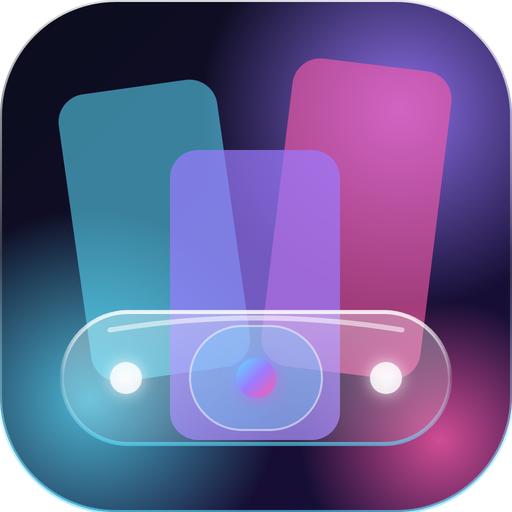
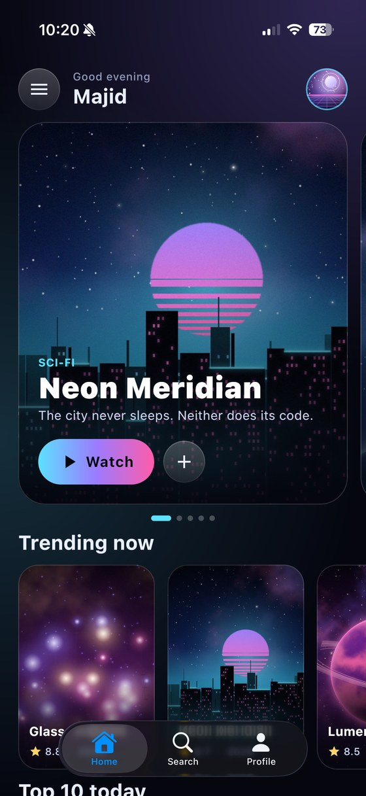
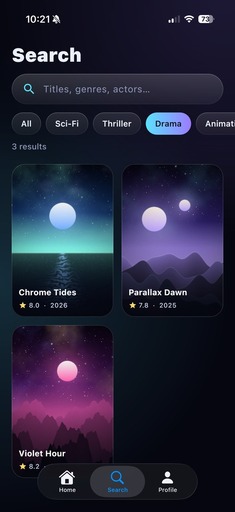
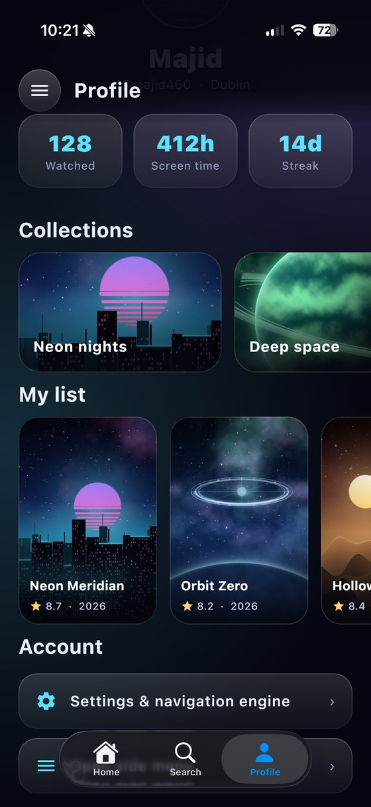
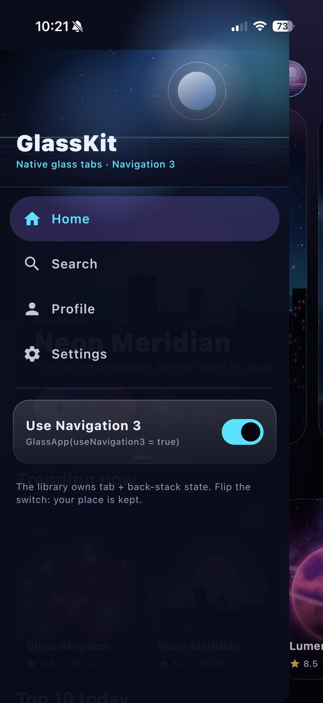
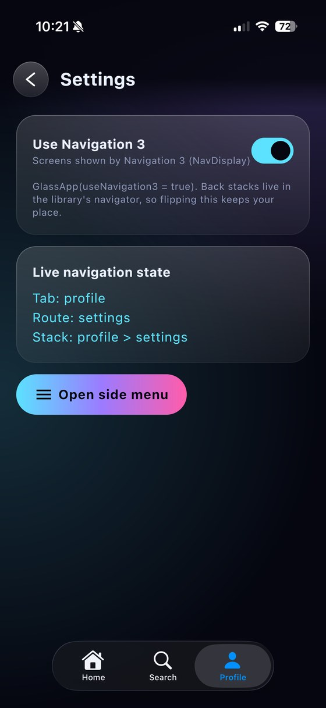
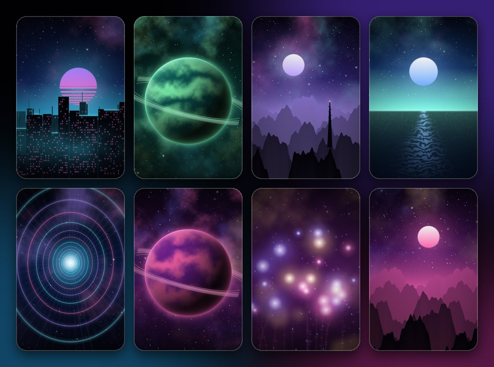
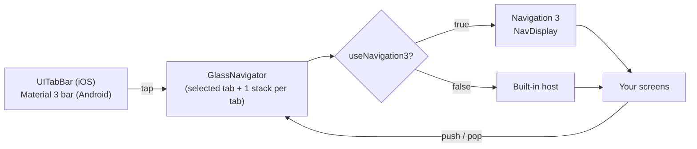

<div align="center">




<a href="https://github.com/Majid460/glasskit">
  
</a>



<p>
  
  
  
  
</p>
<p>
  
  
  
</p>


</div>


## `> WHAT IS THIS`

**GlassKit** is a Kotlin Multiplatform library that gives a Compose Multiplatform app a **native iOS 26 Liquid Glass tab bar** on iOS and a **Material 3 navigation bar** on Android, behind one API, with **all navigation state kept in Kotlin**.

### The problem it solves

Compose Multiplatform draws its own UI, so it cannot render the system Liquid Glass tab bar. The usual workarounds are:

1. **Imitate the bar in Compose.** It looks close but is not the real glass, and does not follow iOS updates.
2. **Wrap the app in a SwiftUI `TabView`.** You get the real bar, but now tab selection and back stacks live in Swift while screens live in Kotlin, and you have to keep both sides in sync.

GlassKit takes a third route: it embeds the real `UITabBar` inside Compose and draws it **on top of your content**, so the glass samples whatever scrolls beneath it. Selection and back stacks stay in a single Kotlin object, so there is no SwiftUI shell and no state to synchronise. (A plain Compose Multiplatform app already has a small Swift launcher, `iosApp`, that just hosts your Compose view controller. GlassKit adds no Swift on top of it.)

| | SwiftUI-shell approach (JetBrains guide) | GlassKit |
|---|---|---|
| iOS tab bar | Native `TabView`, owned by Swift | Native `UITabBar`, drawn over your content |
| Navigation state | Mirrored between Swift and Kotlin | One Kotlin owner (`GlassNavigator`) |
| Back stack per tab | Hand-rolled | Built in, survives config changes |
| Side drawer | Hand-rolled | Optional slot, gestures only on root screens |
| Navigation 3 | Wire it yourself | `useNavigation3 = true` |
| Swift you write for the bar | A SwiftUI `TabView` / `NavigationStack` shell | None. Only the standard iOS launcher (`iosApp`) that every CMP app already has |


## `> SCREENSHOTS`

Real screenshots from the sample app running on an iPhone (iOS 26). The bar is the system `UITabBar`; note the posters and cards showing through and scrolling behind it.

<div align="center">
<table>
  <tr>
    <td align="center"><br/><sub><b>Home</b><br/>hero pager, rows scroll under the glass bar</sub></td>
    <td align="center"><br/><sub><b>Search</b><br/>live filter and genre chips</sub></td>
    <td align="center"><br/><sub><b>Profile</b><br/>content passes behind the bar</sub></td>
  </tr>
  <tr>
    <td align="center"><br/><sub><b>Side drawer</b><br/>includes the Navigation 3 switch</sub></td>
    <td align="center"><br/><sub><b>Settings</b><br/>live navigation state</sub></td>
    <td align="center"><br/><sub><b>Sample art</b><br/>generated posters</sub></td>
  </tr>
</table>
</div>


## `> INSTALL`

GlassKit is **not published yet** (it is `0.1.0-SNAPSHOT`). For now, copy the `glasskit/` module into your project:

```kotlin
// settings.gradle.kts
include(":glasskit")

// shared/build.gradle.kts
commonMain.dependencies { implementation(project(":glasskit")) }
```

Maven Central coordinates are planned as `io.github.majid460:glasskit`.

### Versions

| Component | Version used |
|---|---|
| GlassKit | `0.1.0-SNAPSHOT` (alpha) |
| Kotlin | 2.2.20 |
| Compose Multiplatform | 1.10.3 |
| Navigation 3 (KMP) | `org.jetbrains.androidx.navigation3:navigation3-ui:1.0.0-alpha06` |
| Android Gradle Plugin | 8.11.1 |
| compileSdk / minSdk | 36 / 24 |
| iOS targets | `iosArm64`, `iosSimulatorArm64` |
| Liquid Glass look | iOS 26 (Xcode 26 SDK). Older iOS shows the standard translucent bar |

Compose Multiplatform 1.12.x needs compileSdk 37 and AGP 9.1, so it is not used yet.


## `> QUICK START`

```kotlin
val tabs = listOf(
    GlassTab("home", "Home", sfSymbol = "house.fill", icon = Icons.Filled.Home),
    GlassTab("search", "Search", sfSymbol = "magnifyingglass", icon = Icons.Filled.Search),
    GlassTab("profile", "Profile", sfSymbol = "person.fill", icon = Icons.Filled.Person),
)

@Composable
fun App() {
    GlassApp(
        tabs = tabs,
        useNavigation3 = true,               // flip to false for the built-in host
        drawerContent = { nav -> /* optional side drawer */ },
    ) {
        screen("home")    { ctx -> HomeScreen(ctx) }
        screen("search")  { ctx -> SearchScreen(ctx) }
        screen("profile") { ctx -> ProfileScreen(ctx) }
        screen("detail")  { ctx -> DetailScreen(ctx.arg) }   // pushed with nav.push("detail", id)
    }
}
```

On iOS, expose it from `MainViewController` as usual (`ComposeUIViewController { App() }`). That is all the iOS wiring there is.

Give scrolling lists `ctx.contentPadding` at the bottom so the last item can scroll clear of the bar while still passing behind it.


## `> API REFERENCE`

### `GlassApp`

| Parameter | Type | Purpose |
|---|---|---|
| `tabs` | `List<GlassTab>` | Tabs shown in the bar. Ids must be non-blank |
| `modifier` | `Modifier` | Applied to the root |
| `startTabId` | `String` | Initially selected tab (defaults to the first) |
| `useNavigation3` | `Boolean` (default `true`) | Choose the screen host, see below |
| `navigator` | `GlassNavigator` | Defaults to `rememberGlassNavigator(...)`. Pass your own to control it from outside |
| `drawerContent` | `(@Composable ColumnScope.(GlassNavigator) -> Unit)?` | Optional modal side drawer |
| `screens` | `GlassScreens.() -> Unit` | Register screens with `screen(route) { ctx -> ... }` |

### `GlassTab`

`GlassTab(id, title, sfSymbol, icon)`: `sfSymbol` is the SF Symbol name used on iOS, `icon` is the `ImageVector` used on Android.

### `GlassScreenContext` (given to every screen)

| Member | Meaning |
|---|---|
| `navigator` | The shared `GlassNavigator` |
| `arg` | Optional string argument passed to `push` |
| `contentPadding` | `PaddingValues` whose bottom equals the measured bar height |

### `GlassNavigator`

| Function / property | What it does |
|---|---|
| `selectTab(id)` | Switch tab; each tab keeps its own back stack |
| `push(route, arg?)` | Push a screen onto the current tab's stack |
| `pop()` | Pop the current tab's stack |
| `popToRoot()` | Clear the current tab down to its root |
| `canPop` | Whether the current tab has something to pop |
| `selectedTabId`, `currentRoute` | Observable current state |
| `backStackSummary` | Human-readable stack, e.g. `profile > settings` |
| `openDrawer()` / `closeDrawer()` | Control the side drawer |

State is saved with `rememberSaveable`, so tabs and stacks survive configuration changes and process recreation.

### Building blocks

| API | Use |
|---|---|
| `GlassScaffold` | Lower-level scaffold if you want the bar without `GlassApp` |
| `Modifier.glass(shape, tint, fillAlpha, borderAlpha)` | Frosted panel styling for your own cards |
| `GlassBackButton(onClick)` | Round glass back button |


## `> THE NAVIGATION 3 SWITCH`

```kotlin
GlassApp(useNavigation3 = true)   // screens hosted by Navigation 3's NavDisplay
GlassApp(useNavigation3 = false)  // GlassKit's lightweight built-in host
```

The flag only chooses **who displays the screens**. Tab selection and back stacks always live in `GlassNavigator`, so flipping the flag at runtime keeps the user exactly where they were. The sample app has the switch in its drawer and in Settings, so you can compare live.

| | `useNavigation3 = true` | `useNavigation3 = false` |
|---|---|---|
| Screen host | Navigation 3 `NavDisplay` + `NavEntry` | Built-in `AnimatedContent` host |
| Dependency at runtime | Uses `navigation3-ui` | Not used (still on the compile classpath) |
| Back on Android | Handled by Navigation 3 | Handled by GlassKit's `PlatformBackHandler` |
| Swipe-back gesture on iOS | Yes | Not yet |
| Transitions | Navigation 3 defaults | Simple GlassKit animation |
| Per-screen saved state | Per entry, keyed by screen id | Saveable state holder per entry |
| Maturity | Depends on Navigation 3, currently **alpha** | Fully under this library's control |
| Your screen code | Identical | Identical |

Rule of thumb: use Navigation 3 if you want its transitions and iOS swipe-back and accept an alpha dependency; use the built-in host if you want the smallest moving parts.




## `> HOW MUCH TIME DOES IT SAVE`

These are the author's **rough estimates** of what it takes to build the same pieces by hand in a Compose Multiplatform app, not measured benchmarks. Your experience will vary.

| Piece you would otherwise build | Rough effort by hand | With GlassKit |
|---|---|---|
| Embed a real `UITabBar` in Compose: delegate lifetime, appearance, real height from `sizeThatFits`, overlay placement, safe area | 1 to 2 days (the overlay and weak-delegate pitfalls cost the most) | included |
| Android/iOS `expect`/`actual` for the bar and back handling | 0.5 day | included |
| Per-tab back stacks with save/restore | 1 to 2 days | included |
| Navigation 3 wiring plus a fallback host | 0.5 to 1 day | one boolean |
| Modal drawer that hides the bar and limits gestures to root screens | 0.5 day | one parameter |
| **Total** | **about 3 to 6 working days** | **roughly an hour to adopt** |

It also removes ongoing cost: no SwiftUI shell to maintain, and no two-sided navigation state to keep consistent.


## `> RUN THE SAMPLE`

```bash
# Android
./gradlew :sample:installDebug

# iOS: open sample/iosApp/iosApp.xcodeproj in Xcode 26, set your Team in
# sample/iosApp/Configuration/Config.xcconfig, pick a simulator or device, Run.
```

Requires Xcode 26 (iOS 26 SDK) for the Liquid Glass look; older iOS shows the standard translucent bar.

## `> PROJECT LAYOUT`

```text
glasskit/           the library (commonMain, androidMain, iosMain)
sample/             movie-gallery demo app (+ iosApp Xcode wrapper)
docs/images/        README art
ARCHITECTURE.md     how the pieces fit
```

## `> STATUS & ROADMAP`

GlassKit is **alpha**. Honest notes:

- [x] Native `UITabBar` embedded as an overlay so content scrolls beneath it
- [x] Per-tab back stacks, drawer, Navigation 3 flag
- [ ] Verify Navigation 3 `1.0.0-alpha06` integration on all targets
- [x] Real iPhone screenshots (a screen recording GIF is still to do)
- [ ] Android: back from a non-first tab root currently exits the app
- [ ] iOS swipe-back only in Navigation 3 mode
- [ ] Compose cannot blur its own backdrop, so the sample's pinned top bars use a dark scrim rather than glass
- [ ] Publish to Maven Central, binary-compatibility-validator

See [TODO.md](TODO.md), [ARCHITECTURE.md](ARCHITECTURE.md), [CONTRIBUTING.md](CONTRIBUTING.md), [CHANGELOG.md](CHANGELOG.md).


## `> MAINTAINER`

<div align="center">
  
  
  <br/>
  
</div>

Built by **Majid Shahbaz**, Android/Kotlin developer in Dublin. If GlassKit saves you a SwiftUI shell, a star helps others find it.

<div align="center">
  
</div>
